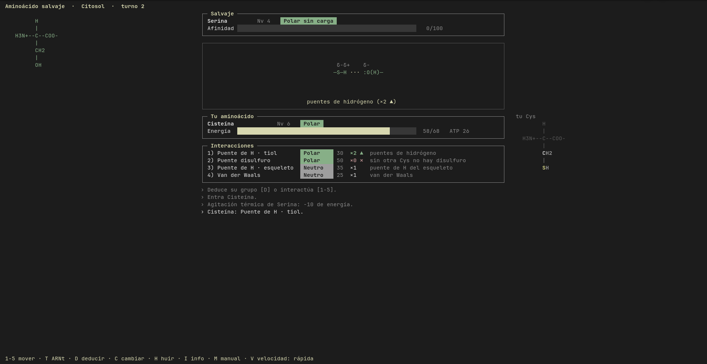
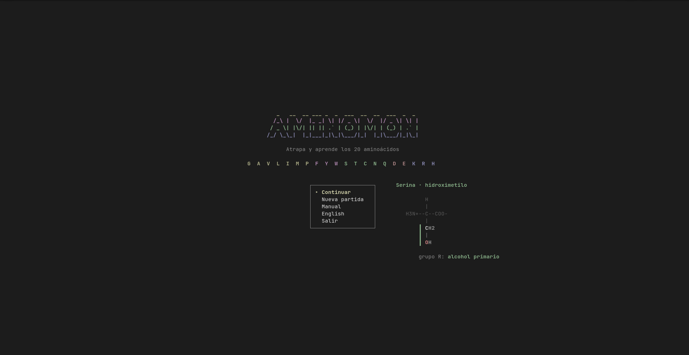
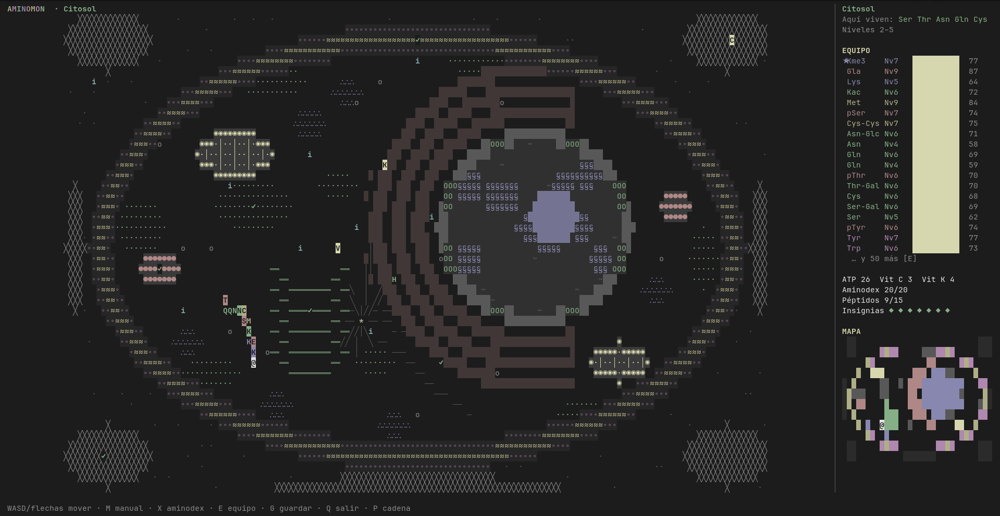

# AMINOMON

*English · [Español](README.es.md)*



A turn-based terminal RPG for learning the 20 standard amino acids. To catch
one you have to recognize its structure, and the ones you miss keep showing up
until you know them: name, 3- and 1-letter codes, side chain, chemical type,
charge, pK1/pK2/pKR, pI, hydropathy, nutritional class, codons and
covalent modifications.

**Who is it for?** Anyone who has to learn the amino acids for a biochemistry
or biology course, from high school to grad school. You don't need to know
anything: the game starts with Met and the manual (M) explains each property.

Values from Lehninger at 25 °C; hydropathy from Kyte-Doolittle (1982)
([Sources](#sources)).

**Play:**

- **Windows:** [Aminomon-Instalador-Windows.exe](https://github.com/leomorgzzz/aminomon/releases/latest/download/Aminomon-Instalador-Windows.exe), install and play.
- **macOS:** [Aminomon-macOS.zip](https://github.com/leomorgzzz/aminomon/releases/latest/download/Aminomon-macOS.zip), unzip and double-click.
- **Linux:** `git clone https://github.com/leomorgzzz/aminomon.git && cd aminomon && ./instalar.sh && aminomon`

> **Work in progress.** The game keeps getting updated: when you open it, it
> tells you if there's a new version and updates from the title screen, no
> reinstall needed. Your save is kept. Bugs, ideas or data to fix:
> [Issues](https://github.com/leomorgzzz/aminomon/issues).

## What's in the game

**The main game.** You explore a cell (cytosol, membrane, ribosomes, ER, Golgi,
lysosome, extracellular matrix, nucleus…) and each area has the amino acids
that make sense there. To catch one you have to recognize its structure: name,
3- and 1-letter codes, then charge, group, pKR, pI, codons or hydropathy. The
ones you miss show up more often. In battle every move is a real interaction of
its R group (salt bridge, cation–π, H-bond…). Leveling up (sometimes with an
item or in a certain area) gives your residues 13 covalent
modifications (phosphoserine,
hydroxyproline, cystine, Gla…).

**The bosses.** 7 area bosses ask you to build a peptide that meets a
condition (an NLS to enter the nucleus, a Gly-X-Y pattern for collagen, a
peptide that becomes charged in the lysosome…). Then comes the Chaperone's
exam.

**After the Chaperone**, with the René-virus (V):

- **Final exam:** translate mRNA and analyze real mutations (sickle cell
  anemia, cystic fibrosis, KRAS, Huntington…).
- **Selenocysteine (Sec, U):** the amino acid outside the 20. Answer how the
  cell puts it in, and it joins your team.
- **Lab:** a room with three benches: titration (put the cursor on a pK or the
  pI of the curve), electrophoresis and ion exchange.
- **Synthesis orders:** 6 real peptides with a story (from RGD to oxytocin and
  the Tat peptide), built on a ribosome codon by codon against the clock.
  There's a special order with Sec, where a UGA is read as Sec thanks to the
  SECIS.
- **The ending:** when you finish everything there's an animation and a
  certificate.

There's also separate practice (spaced review, time attack, pick the
structure), achievements and a manual with a codon cheat sheet.

## Screenshots





## Installation

### Linux, or from source

```bash
git clone https://github.com/leomorgzzz/aminomon.git
cd aminomon
./instalar.sh        # creates the `aminomon` command in ~/.local/bin
aminomon
```

Without installing: `python3 aminomon.py`. Update: `aminomon --update` (runs
`git pull`). Remove the command: `./instalar.sh --quitar`.

From source it needs Python 3 (standard library only; on Windows it installs
`windows-curses` the first time). Works from 80×24.

### Windows

1. Download **[Aminomon-Instalador-Windows.exe](https://github.com/leomorgzzz/aminomon/releases/latest/download/Aminomon-Instalador-Windows.exe)** and open it.
2. Follow the installer (no admin rights needed). When it's done, the game is
   in the Start menu and, if you want, on the desktop. It opens full screen.

The installer isn't signed (signing costs a yearly license), so the first time
Windows may warn "Windows protected your PC": **More info → Run anyway**. It
only happens when installing. To uninstall: **Settings → Apps**.

### macOS

1. Download **[Aminomon-macOS.zip](https://github.com/leomorgzzz/aminomon/releases/latest/download/Aminomon-macOS.zip)** and open it.
2. Double-click `Aminomon`. If macOS won't open it: **System Settings →
   Privacy & Security → Open Anyway**.

For Macs with Apple silicon (M1 or later).

### What it saves and what it connects to

It only writes these files:

- `~/.aminomon.json`: your save (on Windows, `~` is `C:\Users\<your user>`);
- `~/.aminomon_idioma`: the language (the first time it follows your system).

Its only connection: on startup it asks GitHub whether there's a new version,
and it sends nothing else. To turn it off: `aminomon --no-update`.

## Leaving full screen

| System | Key |
|---|---|
| Windows | Alt+Enter (or F11 in Windows Terminal) |
| macOS | Ctrl+Cmd+F |
| Linux | F11 in most terminals |

## Controls

| Map | Action |
|---|---|
| Arrows / WASD | move |
| M / ? | manual (also in battle) |
| X | Aminodex (P practice, L achievements) |
| E | team: leader (Enter), sort (O), modify (V) |
| B | sound when right or wrong (on/off) |
| G / Q | save / save and quit |
| P | show or hide the chain that follows you |

| Battle | Action |
|---|---|
| 1-5 | interactions |
| D | deduce the rival's group |
| T | throw a tRNA to catch |
| C / H / I | switch / run / interaction details |
| V | animation speed |

Any key skips an animation.

## Menu

- **Continue** / **New game**.
- **Manual**.
- **Español / English**: switches the language.
- **Update to vX**: shows up when there's a new version.
- **Quit**.

## Sources

- Physicochemical values and side-chain groups: Lehninger, at 25 °C.
- Hydropathy: Kyte-Doolittle scale (1982).

## Tests

```bash
python3 pruebas/correr.py
```

They check that everything imports in both languages, that every `tr("…")`
has its translation in `traduccion/`, that the data doesn't stay in Spanish in
the English version, and that only symbols the Windows console can draw are
used. They also check the logic: that the ribosome always offers the right
tRNA, that each order's mRNA codes for its peptide, that every pK and the pI
can be reached in the titration, and that an old save loads. They run on GitHub on every push and before building a release.

## License

MIT · [LICENSE](LICENSE)
